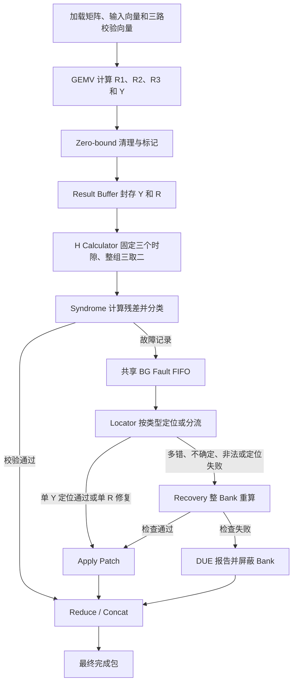

# V3 系统波形逐步查看手册

本手册对应当前 `system_8_evidence` 波形，按 V3 流程图解释全部 119 个显示信号，包括含义、有效时机、数值判断和典型案例。系统采用 FP16、每 Bank 16 个元素、四个 Bank 共享一个 BG。

当前系统仿真包含 66 个测试事务，以及一次 Recovery 中复位、重载后的完成包，共 67 个完成包。波形从 0 ns 记录到 123120 ns。详细内部信号展示 Bank0，四个 Bank 的结果均参与自动审计。本文时间均为 ns，测试编号均为十进制。

## 1. 打开文件和选择显示格式

| 文件 | 用途 |
|---|---|
| `build/system/system_8_evidence.vcd` | 通用波形，支持 VCD 的查看器可打开 |
| `build/system/system_8_evidence.wdb` | Vivado XSim 原生数据库 |
| `build/system/system_8_evidence.wcfg` | 与 WDB 配套的分组和显示名称 |
| `build/system/system_8_evidence_signals.csv` | 显示名称与测试平台探针的对应表 |
| `build/system/system_8_evidence_coverage.csv` | 每个测试事务的实际时间和最终状态 |
| `build/system/system_8_evidence_timeline.csv` | 定位、修复、Recovery 和 DUE 的实际握手时刻 |
| `build/system/system_8_evidence_results.csv` | 完成包 Y 的 FP16 编码、解码值和参考结果 |
| `build/system/system_8_evidence_syndromes.csv` | 四个 Bank 每个结果包的三路 R、H、残差和分类 |

从工程根目录找到这些文件。重新生成使用以下命令。

```powershell
powershell.exe -NoProfile -ExecutionPolicy Bypass -File .\scripts\run_system_simulation.ps1 -Evidence
```

该命令先运行 FIFO 深度 1 的全系统反压测试，再运行深度 8 并更新同名波形。自动审计通过后，VCD 精简为本文列出的信号，WCFG 显示相同名称。FIFO 深度 1 的队满检查位于该轮仿真日志，本文时间索引对应深度 8 的波形。

| 名称或格式 | 读取方法 |
|---|---|
| `b0_` | Bank0 的信号 |
| `bg_` | 四个 Bank 共享的故障队列和 Locator |
| `_fp16` | 16 位 binary16 浮点数 |
| `_fp16x16` | 打包的 16 个 FP16，共 256 位 |
| `_fp16x64` | 打包的 64 个 FP16，共 1024 位 |
| `_fp16x12` | 打包的 12 个 FP16，共 192 位 |
| `_watch_` | 只观察 `b0_watch_index` 选中的一个元素 |
| 编号、次数、下标、类型 | 按整数读取，`bg_y_index` 使用有符号整数 |
| `_mask` | 按位读取，通常使用二进制或十六进制 |

FP16 总线最低 16 位对应元素 0，即 `[15:0]`。元素 i 对应 `[16*i+15:16*i]`。十六进制长字符串最右侧四位是元素 0。

| FP16 十六进制 | 数值 |
|---|---:|
| `0000` | +0 |
| `0001` | 最小正非正规数，约 5.96×10⁻⁸ |
| `3800` | 0.5 |
| `3c00` | 1 |
| `4400` | 4 |
| `4480` | 4.5 |
| `c400` | −4 |
| `7bff` | 65504 |
| `7c00` / `fc00` | +Inf / −Inf |
| `7e00` | 一种 NaN 编码 |

## 2. 沿 V3 流程查看



三种时间点要分别读取。

- 握手发生在 `clk` 上升沿，使用该沿之前的 valid/ready 判断。
- `slot_done`、`accepted`、`capture` 等事件信号为 1 时，也在时钟上升沿读取关联数据。
- 寄存器在采样沿之后更新。比较 H 时读取沿前的 current/first/previous，查看保存结果时读取沿后。

波形中一条总线保持为零，可能表示数值确实为零，也可能处于无效窗口。残差使用 `b0_delta_valid`，最终输出使用 `result_valid`，Recovery 结果使用 `recovery_result_accepted`。

## 3. 系统任务与启动

对应分组 `01_System`。

| 信号 | 位宽 | 含义与读取时机 |
|---|---:|---|
| `clk` | 1 | 时钟，当前周期为 10 ns |
| `rst_n` | 1 | 低有效复位，0 表示复位中 |
| `test_id` | 32 | 当前测试平台任务编号，启动前可能已经改变 |
| `mode_qk` | 1 | 1 为 qK 加法树主计算，0 为 pV 累加主计算 |
| `start_valid` | 1 | 外部提交任务 |
| `start_ready` | 1 | 系统可以接受新任务 |
| `result_valid` | 1 | 完成包有效，读取最终 Y、R 和状态 mask |
| `result_ready` | 1 | 下游可以接收完成包，和 valid 同为 1 的上升沿完成接收 |
| `corrected_mask` | 4 | 成功修复的 Bank，包含 Recovery 成功，完成包有效时读取 |
| `recovered_mask` | 4 | 通过 Recovery 重算成功的 Bank，完成包有效时读取 |
| `due_mask` | 4 | 最终无法恢复的 Bank，完成包有效时读取 |
| `result_matches_reference` | 1 | 测试平台比较完整 Y、R、修复状态与参考完成包的结果，result_valid 时读取 |

三个状态 mask 的 bit0/1/2/3 对应 Bank0/1/2/3。例如 `corrected_mask=1` 表示 Bank0 修复成功，`recovered_mask=1` 表示 Bank0 通过 Recovery 修复。DUE 案例的参考完成包也遵循失败 Bank 屏蔽规则。

## 4. 加载矩阵、输入向量和校验向量

对应分组 `02_Inputs`。

| 信号 | 位宽 | 含义与读取时机 |
|---|---:|---|
| `matrix_load_valid` | 1 | 外部矩阵行有效 |
| `matrix_load_ready` | 1 | 系统可以接收矩阵行 |
| `matrix_load_bank` | 2 | 这行矩阵写入的 Bank，加载握手时读取 |
| `matrix_load_row` | 5 | 写入行号，当前有效范围为 0～15 |
| `matrix_load_row_fp16x16` | 256 | 当前一行的 16 个矩阵元素，加载握手时读取 |
| `checksum_load_valid` | 1 | 外部三路校验向量有效 |
| `checksum_load_ready` | 1 | 系统可以接收校验向量 |
| `checksum_load_bank` | 2 | 校验向量写入哪个 Bank，校验加载握手时读取 |
| `checksum_e_fp16x16` | 256 | 外部加载的 Ce，全 1 权重的校验向量 |
| `checksum_w_fp16x16` | 256 | 外部加载的 Cw，权重 w 的校验向量 |
| `checksum_inv_w_fp16x16` | 256 | 外部加载的 C_inv_w，权重 1/w 的校验向量 |
| `b0_x_fp16x16` | 256 | Bank0 锁存的输入向量，任务被接受后读取 |
| `b0_watch_index` | 4 | 当前观察元素的下标，0 起算 |
| `b0_x_watch_fp16` | 16 | Bank0 输入向量中 watch_index 位置的元素 |
| `matrix_load_watch_fp16` | 16 | 当前加载行中 watch_index 位置的元素，结合加载 Bank 和行号读取 |

上升沿 valid 和 ready 同为 1 才发生加载。共享加载口每次写一个 Bank 的一行，因此 `matrix_load_row_fp16x16` 是 256 位。四个 Bank 的输入向量在系统内部一共 1024 位，精简波形展示其中 Bank0 的 256 位。

qK 的输入向量是 q，pV 的输入向量是 p。当前权重 w[i]=i+1，逆权重为 FP16 编码的 1/(i+1)。

`b0_watch_index` 在 test_id=48、51 时为 0，在 49、50 时为 15，其余为 3。带 watch 的信号可以跟踪首项、末项或通常使用的 Y[3]。波形中的 Y3 旧名称已由 watch 名称替代。

## 5. FSM 与 GEMV 主计算

对应分组 `03_Bank0_GEMV`。

| 信号 | 位宽 | 含义与读取时机 |
|---|---:|---|
| `b0_gemv_phase` | 3 | 当前 GEMV 任务类型，见下表 |
| `b0_is_recovery` | 1 | 0 是首次计算，1 是 Recovery 请求的重新计算 |
| `b0_gemv_tree_mode` | 1 | 当前 GEMV 使用加法树还是累加器，1 为加法树 |
| `b0_gemv_valid` | 1 | GEMV 当前输入拍有效 |
| `b0_gemv_ready` | 1 | GEMV 可以接收输入拍 |
| `b0_matrix_read_row` | 5 | Bank0 当前读取的存储行，计算 R/H 时不代表其输入来源 |
| `b0_fault_injection_active` | 1 | 测试平台正在强制 GEMV 返回总线 |
| `b0_injected_value_fp16x16` | 256 | 被强制的返回值，注错活动时结合 phase 和写入下标读取 |

| phase 数值 | 当前计算 |
|---:|---|
| 0 | R1 |
| 1 | R2 |
| 5 | R3 |
| 2 | Y |
| 3 | H1 |
| 4 | H2 |
| 6 | H3 |

执行顺序为 R1 → R2 → R3 → Y → 三个 H 时隙。R/H 均使用加法树，因此 mode_qk=0 的 pV 任务在计算 R/H 时也会看到 b0_gemv_tree_mode=1。

每个主计算与校验量都复用实际 GEMV。R1=Ce·x，R2=Cw·x，R3=C_inv_w·x。H 从已经保存的 Y 得到，H1=sum(Y[i])，H2=sum(w[i]Y[i])，H3=sum(FP16(1/w[i])Y[i])。

测试平台会强制一串返回拍，其中某些拍可能被写入与原计算相同的数。判断哪一项被改变，要结合输入、注入值和后续缓冲值。

## 6. Zero-bound 特殊值检查

对应分组 `04_Bank0_ZeroBound`。

| 信号 | 位宽 | 含义与读取时机 |
|---|---:|---|
| `b0_zb_capture` | 1 | 这一拍清理后的 Y 或 R 将被缓冲接收 |
| `b0_zb_input_fp16x16` | 256 | 清理前的 GEMV 返回值，capture 时读取 |
| `b0_zb_output_fp16x16` | 256 | 清理后的结果，capture 时读取 |
| `b0_zb_special_mask` | 16 | 每位对应一个元素，1 表示该元素被置为正零 |
| `b0_zb_lane0_input_fp16` | 16 | 原始总线最低 16 位，便于观察 qK/R 标量 |
| `b0_zb_lane0_output_fp16` | 16 | 清理后总线最低 16 位 |

当前默认上界为 7bff，即 65504。NaN、正负 Inf、绝对值大于或等于上界的元素均置为 0000，并置对应 mask 位。0001 是有限的非正规数，在当前配置下通过此检查。

qK 的单次点积结果放在原始总线的 lane0。假设这一拍属于 Y[3]，特殊值会先使 b0_zb_special_mask[0]=1，写缓冲时再通过 write_index=3 标记 Y[3]。

pV 返回整个向量，mask 按 16 项的位置对应。H 的非有限值由 H 表决控制器判断，读取 Zero-bound 数据时以 capture 窗口为准。

## 7. Result Buffer 保存结果

对应分组 `05_Bank0_ResultBuffer`。

| 信号 | 位宽 | 含义与读取时机 |
|---|---:|---|
| `b0_buffer_write_y` | 1 | 正在把本次 GEMV 的 Y 写入缓冲 |
| `b0_buffer_write_index` | 32 | qK 模式当前保存的 Y 下标，write_y 时读取 |
| `b0_buffer_seal` | 1 | 收集完成，封存 Y 和三路 R |
| `b0_buffer_valid` | 1 | 缓冲已完整，可供 H 计算读取 |
| `b0_buffer_y_fp16x16` | 256 | 当前主计算或 Recovery 的完整 Y |
| `b0_buffer_y_watch_fp16` | 16 | 上述 Y 中 watch_index 指定的一项 |
| `b0_buffer_y_special_mask` | 16 | 每个 Y 元素曾被 Zero-bound 清理的记录 |
| `b0_buffer_r_special_mask` | 3 | bit0/1/2 对应 R1/R2/R3 的清理记录 |
| `b0_r1_fp16` | 16 | 本次 GEMV 得到并保存的 R1 |
| `b0_r2_fp16` | 16 | 本次 GEMV 得到并保存的 R2 |
| `b0_r3_fp16` | 16 | 本次 GEMV 得到并保存的 R3 |

三路 R 和完整 Y 在 buffer_seal 时已经收齐。pV 一次写完整向量，write_index 主要用于解释 qK 的逐项写入。

`b0_buffer_y_watch_fp16` 从 256 位 Y 中抽出一个 16 位元素，用于查看故障是否进入缓冲。Apply Patch 更新独立的结果存储，最终写回值见 `b0_patched_y_watch_fp16`。

## 8. H Calculator/Control 固定三轮与三取二

对应分组 `06_Bank0_H_Vote`。每轮处理一整个 H1/H2/H3 组。

| 信号 | 位宽 | 含义与读取时机 |
|---|---:|---|
| `b0_h_start` | 1 | H 控制器收到本次检查请求 |
| `b0_h_slot_done` | 1 | 当前时隙结束的采样握手，在它为 1 的 clk 上升沿完成这一轮 |
| `b0_h_completed_slots` | 2 | 完成的时隙数，采样沿后依次更新为 1、2、3 |
| `b0_h_idle_slot` | 1 | 前两轮一致，当前第三轮空转 |
| `b0_h_capture_third_channel` | 1 | 实际捕获本轮 H3 的事件，可用于确认这一轮确实完成 GEMV |
| `b0_h_current1_fp16` | 16 | 本轮候选 H1，slot_done 的采样沿前读取 |
| `b0_h_current2_fp16` | 16 | 本轮候选 H2 |
| `b0_h_current3_fp16` | 16 | 本轮候选 H3 |
| `b0_h_first1_fp16` | 16 | 第一轮保存的 H1 |
| `b0_h_first2_fp16` | 16 | 第一轮保存的 H2 |
| `b0_h_first3_fp16` | 16 | 第一轮保存的 H3 |
| `b0_h_previous1_fp16` | 16 | 最近一轮实际采样的 H1，采样沿后更新 |
| `b0_h_previous2_fp16` | 16 | 最近一轮实际采样的 H2 |
| `b0_h_previous3_fp16` | 16 | 最近一轮实际采样的 H3 |
| `b0_h_current_finite` | 1 | 当前三个候选都为有限数，实际采样轮的 slot_done 窗口读取 |
| `b0_h_matches_first` | 1 | 第三轮当前组与第一组匹配，仅采样握手窗口有效 |
| `b0_h_matches_previous` | 1 | 当前组与上一组匹配，仅采样握手窗口有效 |
| `b0_h_commit` | 1 | 第三时隙结束，已有有效的多数 H 组 |
| `b0_h_fail` | 1 | 第三时隙结束，找不到有效多数 |

first1/2/3 末尾的编号表示 H 通道。它们合起来只保存第一轮结果，因此一个任务中只写入一次。previous 保存最近一次实际采样结果，连续写入相同数据时，波形数值保持不变。

| 时隙 | 前两轮将会一致的路径 | 前两轮不同的路径 |
|---|---|---|
| 第 1 轮 | 实算，保存 first 和 previous | 实算，保存 first 和 previous |
| 第 2 轮 | 实算，与 previous 比较，更新 previous | 实算，比较失败后更新 previous |
| 第 3 轮 | 空转，slot_done 后提交第一组 | 实算，与第一组、上一组比较，得到多数或失败 |

slot_done 两条路径都出现三次。前两轮一致时，capture_third_channel 只出现两次，第三时隙 idle_slot=1。当前每时隙为 80 ns，从 H 启动握手到 commit/fail 为 240 ns。

H 表决采用有限、逐位一致的完整组。分别从 H1、H2、H3 各选一个多数值来拼组，不符合当前提交规则。H 三取二完成后，仍要比较 R 和最终 H。

## 9. Syndrome Checker 与错误分类

对应分组 `07_Bank0_Syndrome`。

| 信号 | 位宽 | 含义与读取时机 |
|---|---:|---|
| `b0_packet_accepted` | 1 | Bank0 结果包被系统接受，采样本包分类和残差 |
| `b0_h1_fp16` | 16 | H 三取二最终选出的 H1 |
| `b0_h2_fp16` | 16 | H 三取二最终选出的 H2 |
| `b0_h3_fp16` | 16 | H 三取二最终选出的 H3 |
| `b0_delta_valid` | 1 | 本包 H 有效且残差可读 |
| `b0_delta1_fp16` | 16 | FP16(R1−H1)，delta_valid 时读取 |
| `b0_delta2_fp16` | 16 | FP16(R2−H2) |
| `b0_delta3_fp16` | 16 | FP16(R3−H3) |
| `b0_mismatch_mask` | 3 | 三路相对阈值检查结果，bit0/1/2 对应通道 1/2/3 |
| `b0_single_error_relation_matches` | 1 | 三路残差的幅值乘积关系是否满足当前容差 |
| `b0_fault_type` | 3 | 本包最终分类，见下表 |
| `b0_fault_enqueued` | 1 | Bank0 的故障记录已被共享 FIFO 接受 |

delta_valid=0 时，RTL 将三路残差输出置零。此时仅看数值为零，无法判断校验是否通过。

### 9.1 mismatch_mask 的计算

对每一路 i，先求 Δi=Ri−Hi，再判断下式。

$$
|\Delta_i| > 2^{-\mathrm{REL\_SHIFT}}\max(|R_i|,|H_i|)
$$

默认 REL_SHIFT=8，阈值为 max(|Ri|,|Hi|)/256。严格大于阈值时该位为 1，等于阈值时为 0。代码也把参与比较的非有限数列为不匹配，特殊值清理 mask 和 H 有效性另外参与 fault_type 分类。

| mask[2:0] | 十进制或十六进制显示 | 含义 |
|---|---:|---|
| 000 | 0 | 三路都在阈值内 |
| 001 | 1 | 第一路超阈值 |
| 010 | 2 | 第二路超阈值 |
| 100 | 4 | 第三路超阈值 |
| 110 | 6 | 第二、三路超阈值 |
| 111 | 7 | 三路都超阈值 |

这里的位数表示异常校验通道数。单个 Y 元素出错也可能产生 111。

例如 test_id=11 的 R1=21、H1=17，Δ1=4。阈值为 21/256≈0.082，第一路置 1，另外两路相等，最终 mask=001。

### 9.2 single_error_relation_matches 的计算

假设只有 Y 的一个元素发生误差，位置权重为 w，需要补回的误差为 e。理想关系为 Δ1=e、Δ2=we、Δ3=e/w，因此 Δ2Δ3=Δ1²。

当前该信号先比较幅值。令 A=|Δ1|²，B=|Δ2||Δ3|，则接受条件为下式。

$$
|A-B| \le 2^{-\mathrm{SINGLE\_SHIFT}}\max(A,B)
$$

默认 SINGLE_SHIFT=8。实现使用 FP16 的 11 位有效尾数乘法、指数对齐和整数比较，同时要求指数和的差不超过 22。该检查避免先把乘积舍入回 FP16。它与相对阈值检查使用独立参数。

| 情况 | Δ1、Δ2、Δ3 | A | B | mismatch | relation |
|---|---|---:|---:|---|---:|
| 正常 | 0、0、0 | 0 | 0 | 000 | 1 |
| test_id=3 单 Y 错 | −4、−16、−1 | 16 | 16 | 111 | 1 |
| test_id=6 双 Y 错 | −8、−20、−5 | 64 | 100 | 111 | 0 |
| test_id=11 单 R1 错 | 4、0、0 | 16 | 0 | 001 | 0 |
| test_id=64 三项错 | −18、−27、−12 | 324 | 324 | 111 | 1 |

relation=1 表示乘积关系通过。Bank 判为单 Y 错，还要求 H 有效、Y/R 无特殊值标记、残差有限、三路均超相对阈值、三路同号、相关乘积非零。正常的全零残差虽然 relation=1，仍因 mismatch=000 分类为正常。

FP16 容差以及多错组合可能让 relation 为 1。test_id=64 的三项错误就满足乘积关系，后续 Locator 因权重 27/18=1.5 与合法整数位置不符而拒绝直接修复，并转入 Recovery。应结合完整分类、定位与重算结果判断处理路径。

### 9.3 fault_type 的含义

| 类型 | 分类条件与动作 |
|---:|---|
| 0 | 检查通过，Bank 结果可以贡献到最终输出 |
| 1 | 符合单 Y 错特征，BG 继续确认合法位置 |
| 2 | 单 R1 错，另两路残差恰好为零且替换值合法，用可信 H1 修复 R1 |
| 3 | 单 R2 错，条件对应上行，用 H2 修复 R2 |
| 4 | 单 R3 错，条件对应上行，用 H3 修复 R3 |
| 5 | 多错或不确定，进入 Recovery |
| 6 | 特殊值、没有有效 H 或非有限残差，进入 Recovery |

## 10. BG Fault FIFO 和 Locator

对应分组 `08_Shared_BG_Locator`。系统只有一个共享 BG，处理来自四个 Bank 的故障。

| 信号 | 位宽 | 含义与读取时机 |
|---|---:|---|
| `bank_fault_valid_mask` | 4 | 哪些 Bank 正在提交故障记录，bit0～3 对应 Bank0～3 |
| `bg_fifo_count` | 32 | 故障 FIFO 当前记录数 |
| `bg_fifo_push` | 1 | 本上升沿有一条记录入队 |
| `bg_fifo_pop` | 1 | 本上升沿有一条记录送给 Locator |
| `bg_search_low_weight` | 5 | 二分搜索的权重下界 |
| `bg_search_high_weight` | 5 | 二分搜索的权重上界 |
| `bg_candidate_accepted` | 1 | 本定位或分流结果被下游接受 |
| `bg_candidate_src` | 16 | 高 8 位任务编号，低 8 位 Bank 编号，候选被接受时读取 |
| `bg_candidate_bank` | 2 | 当前候选属于哪个 Bank |
| `bg_fault_type` | 3 | 当前共享记录的分类，与该 Bank 原故障记录对应 |
| `bg_patch_possible` | 1 | 当前候选可直接提交单项补丁 |
| `bg_locator_reason` | 3 | 定位失败原因，见下表 |
| `bg_search_steps` | 4 | 执行过的二分搜索次数，16 项时最多 4 步 |
| `bg_y_index` | 16 | 单 Y 修复的 0 起算下标，使用有符号整数显示 |
| `bg_buffer_y_fp16` | 16 | Locator 当前 lookup 位置读到的原始缓冲值，随搜索位置变化 |
| `bg_patch_value_fp16` | 16 | 准备提交的单 Y 修正值或单 R 替换值，候选被接受时读取 |

二分搜索范围使用权重 1～16，最终 Y 下标为权重减 1。搜索通过残差幅值比较完成。对单 Y 错，修正值为 FP16(被选中的错误 Y+Δ1)。

`bg_buffer_y_fp16` 是搜索时的读口数据，随 lookup 地址变化。核对最终修复值时，用候选的 y_index 定位缓冲完整向量中的旧值，并结合 patch_value 和 patch_applied。

type=2/3/4 直接修复对应 R。此时 patch_possible=1，但 y_index 为 −1，因为补丁目标由类型确定。type=5/6 直接分流至 Recovery，search_steps 可以为 0。

| locator_reason | 含义 |
|---:|---|
| 0 | 无定位错误，直接分流的记录也可能为 0 |
| 1 | 输入定位残差非有限 |
| 2 | Δ1 为零 |
| 3 | 定位所需的残差符号不符 |
| 4 | 位置超范围，或候选权重与合法整数权重偏差过大 |
| 5 | 选中 Y 非有限，或修正值达到/超过当前固定边界或非有限 |

原因 1/2/3 等是 Locator 的防御检查。Bank 已提前分流大部分此类记录，所以完整系统中未必经过每个 Locator 防御分支。

## 11. Apply Patch 和 Recovery

对应分组 `09_Recovery`，包括直接修复和重算写回两条路径。

| 信号 | 位宽 | 含义与读取时机 |
|---|---:|---|
| `recovery_request_accepted` | 1 | 本上升沿接受整 Bank 重算请求 |
| `recovery_src` | 16 | 高 8 位任务编号，低 8 位 Bank 编号，请求或返回事件时读取 |
| `recovery_bank` | 2 | 当前重算的 Bank |
| `recovery_result_accepted` | 1 | 本上升沿接收重算完成包 |
| `recovery_checks_pass` | 1 | 该重算包通过完整检查，在 result_accepted 时读取 |
| `recovery_y_watch_fp16` | 16 | 当前共享重算响应中 watch_index 位置的 Y，结合 recovery_bank 读取 |
| `patch_applied` | 1 | 写回已完成的状态脉冲，关联结果存储已经更新 |
| `patch_bank` | 2 | 本次写回的 Bank，patch_applied 时读取 |
| `patch_is_full_bank` | 1 | 0 为单 Y 或单 R 修复，1 为 Recovery 的整 Bank Y/R 写回 |
| `b0_patched_y_watch_fp16` | 16 | Bank0 最终结果存储中 watch_index 指定的 Y |

直接单 Y 修复依次观察 candidate_accepted、patch_applied 和 b0_patched_y_watch_fp16。单 R 修复改写 R，最终对应 R 在 output_r_fp16x12 中检查。

Recovery 复用实际 Bank GEMV，再次计算 R、Y、固定三时隙 H，并执行特殊值与三路校验。recovery_result_accepted 时 checks_pass=1 才提交整 Bank 补丁，checks_pass=0 则生成 DUE。

重算的 Y 与单项候选相等，不能单独证明重算通过。是否接受重算，以返回完成包的整套检查结果为准。

Apply Patch 存储会屏蔽尚未解决的 Bank，因此 b0_patched_y_watch_fp16 在修复前可以为 0。它与 Result Buffer 的故障值属于不同观察位置。Recovery 开始后，Bank 内的 R/H/缓冲会重新装载本次重算结果，读取时结合 b0_is_recovery。

## 12. DUE 与 Reduce/Concat 输出

对应分组 `10_DUE_and_Output`。

| 信号 | 位宽 | 含义与读取时机 |
|---|---:|---|
| `due_valid` | 1 | 有 DUE 报告等待接收 |
| `due_ready` | 1 | 下游可以接收 DUE，上升沿与 valid 同为 1 完成握手 |
| `due_src` | 16 | 报告来源，高 8 位任务编号，低 8 位 Bank 编号，valid 时读取 |
| `due_reason` | 8 | 当前 01 表示 Recovery 检查失败 |
| `reduce_skip_mask` | 4 | 每位为 1 表示该 Bank 暂不贡献输出 |
| `output_y_fp16x64` | 1024 | 最终 Y 拼接或归约输出，result_valid 时读取 |
| `reference_y_fp16x64` | 1024 | 测试平台参考完成包的 Y，result_valid 时比较 |
| `output_r_fp16x12` | 192 | 最终 R 拼接或归约输出，result_valid 时读取 |
| `reference_r_fp16x12` | 192 | 参考完成包的 R，result_valid 时比较 |
| `b0_reference_y_watch_fp16` | 16 | 最终参考输出中 watch_index 对应项，含义随全局模式变化 |

reduce_skip_mask 在处理中也会屏蔽尚未解决的 Bank。成功修复后解除对应屏蔽，DUE 的 Bank 在最终包中继续屏蔽。

qK 输出按 Bank0、Bank1、Bank2、Bank3 从低位到高位拼接。每 Bank 的 Y 占 256 位，R 占 48 位，R 组内低到高为 R1、R2、R3。

pV 输出按 ((Bank0+Bank1)+Bank2)+Bank3 逐步 FP16 舍入求和。Y 的低 256 位有效，高 768 位填零。R 的低 48 位有效，高 144 位填零。

b0_reference_y_watch_fp16 取自最终参考输出的低 Bank 区域。qK 下它对应 Bank0 的被观察项，pV 下它对应四 Bank 归约后的被观察项。因此 pV 时，应将最终 output_y 的该项与参考值比较，单 Bank 修正值可以和整个归约参考值不同。

result_matches_reference 来自测试平台，比较的是 Y、R 与修复状态。DUE 的参考输出按失败 Bank 屏蔽后计算。它为 1 表示完成包符合本案例规定的预期行为。

## 13. 先跟着这些案例看完整过程

### 13.1 单 Y 修复，test_id=3

Bank0 的矩阵为单位阵，输入向量为 [0.125,0.25,…,2]。Y[3] 理论值为 0.5，测试平台将它改成 4.5。R=(17,187,2)，H=(21,203,3)，残差为 (−4,−16,−1)。

| 时间 ns | 查看内容 | 预期 |
|---:|---|---|
| 3605 | 启动握手 | test_id=3，mode_qk=1 |
| 4005 | buffer_seal | buffer_y_watch=4.5，三路 R 完整 |
| 4015 | H 启动握手 | 开始固定三个时隙 |
| 4095 / 4175 | 前两轮 H 采样 | 两组均为 (21,203,3) |
| 4255 | 第三轮空转结束 | completed_slots=3，commit=1 |
| 4345 | candidate_accepted | type=1，patch_possible=1，y_index=3，patch_value=0.5 |
| 4355 | patch_applied | patch_bank=0，patch_is_full_bank=0 |
| 4365 | result_valid | corrected_mask=1，recovered_mask=0，due_mask=0 |

### 13.2 单 R1 修复，test_id=11

启动为 19205 ns，完成为 19915 ns。19875 ns 的 Bank0 主结果包中，R=(21,187,2)，H=(17,187,2)，残差为 (4,0,0)，mismatch=001，fault_type=2。

19895 ns 接受候选，19905 ns 完成单项写回。此例修复 R1，Y 的被观察项可以保持原值。最后检查 output_r 中 Bank0 的 R1 恢复为 17。

### 13.3 双错后 Recovery 成功，test_id=6

启动为 8845 ns。主计算残差为 (−8,−20,−5)，单错幅值乘积关系失败，type=5。

| 时间 ns | 事件 | 预期 |
|---:|---|---|
| 9535 | candidate_accepted | patch_possible=0 |
| 9555 | recovery_request_accepted | Bank0 开始整 Bank 重算 |
| 10225 | recovery_result_accepted | checks_pass=1 |
| 10245 | patch_applied | patch_is_full_bank=1 |
| 10255 | result_valid | corrected_mask=1，recovered_mask=1，due_mask=0 |

### 13.4 持续错误后 DUE，test_id=13

启动为 23825 ns。24535 ns 接受 Recovery 请求，25205 ns 接受重算结果，此时 checks_pass=0。随后产生 DUE。

25225 ns 最终完成包有效，due_mask=1。25355 ns 下游接受 DUE 报告。result_valid 与 due_valid/ready 是独立握手，报告等待接收期间可以保持 due_valid=1。

### 13.5 关系成立但位置拒绝，test_id=64

启动为 116865 ns，完成为 118325 ns。实际有三个 Y 元素出错，但残差 (−18,−27,−12) 的两个幅值乘积同为 324，relation=1，Bank 分类为 1。

117605 ns 接受定位结果，patch_possible=0、locator_reason=4。权重 27/18=1.5 与合法整数位置不符。117625 ns 转入 Recovery，118295 ns 重算通过，118315 ns 整 Bank 写回。

## 14. 常用案例定位表

下表范围从启动到最终结果有效。DUE 报告可能在该范围之后完成接收。

| test_id | 启动→完成 ns | 用途 |
|---:|---|---|
| 1 | 755→1435 | 正常 qK，H 第三轮空转 |
| 2 | 2255→2785 | 正常 pV |
| 3 | 3605→4365 | Bank0 Y[3] 直接修复 |
| 6 | 8845→10255 | Bank0 双错，Recovery 成功 |
| 10 | 17565→18385 | 四 Bank 同时单错，共享 BG 保序 |
| 11 | 19205→19915 | 仅 R1 错，只有 Δ1 非零 |
| 13 | 23825→25225 | 持续错误，重算失败后 DUE |
| 21 | 37165→40665 | 四 Bank DUE，报告反压 |
| 25 / 26 / 27 | 45625→47035 / 47855→49265 / 50085→51195 | Y 的 NaN、+Inf、−Inf |
| 28 / 29 | 52015→53425 / 54245→55655 | Y 达到正、负上界 |
| 30 | 56475→57585 | pV 混合特殊值、有限值与负零 |
| 36 | 68555→69965 | 三组 H 均不同，进入 Recovery |
| 37 | 70785→71465 | H 第三轮匹配第二轮 |
| 38 | 72285→73685 | 主计算和 Recovery 的 H 均失败 |
| 41 | 78195→78875 | H 按 A/B/A，第三轮匹配第一轮 |
| 42 | 79695→81105 | H 分量各有多数，但整组无多数 |
| 44 / 45 | 83275→83985 / 84805→85515 | 单 R2、单 R3 修复 |
| 46 | 86335→87015 | 第二轮只有 H3 出错 |
| 48 / 49 | 89185→89945 / 90765→91525 | qK 首项、末项单错 |
| 50 / 51 | 92345→92955 / 93775→94385 | pV 末项、首项负向误差 |
| 52 | 95205→96615 | 双错抵消使 Δ1=0，其他残差非零 |
| 54 / 55 / 56 | 99365→100775 / 101595→102705 / 103525→104935 | R3 的 NaN、+Inf、near-INF |
| 57 | 105755→106435 | 首轮 H3 为 NaN，后两轮匹配 |
| 58 | 107255→108665 | 前两轮 H 同样错误，Syndrome 检出后重算 |
| 61 / 62 / 63 | 112335→113015 / 113835→114515 / 115335→116045 | 相对阈值下方、等于、上方 |
| 64 | 116865→118325 | 三项错误通过关系检查，但定位拒绝 |
| 65 | 119145→119825 | 最小正非正规数输入 |
| 66 | 120645→121175 | 正常事务，之后中断一次 Recovery 并复位 |
| 66，重载后 | 122585→123115 | 复位重载后重新完成 |

test_id=61/62 故意把 R1 改到阈值以内或恰好等于阈值，当前设计接受该偏差，参考完成包也保留同样的 R1。test_id=63 越过阈值后修复 R1。

本手册记录当前测试覆盖的功能场景和实际波形时刻。RTL 参数、激励或调度改变后，应重新生成波形并核对这里的时间索引。
